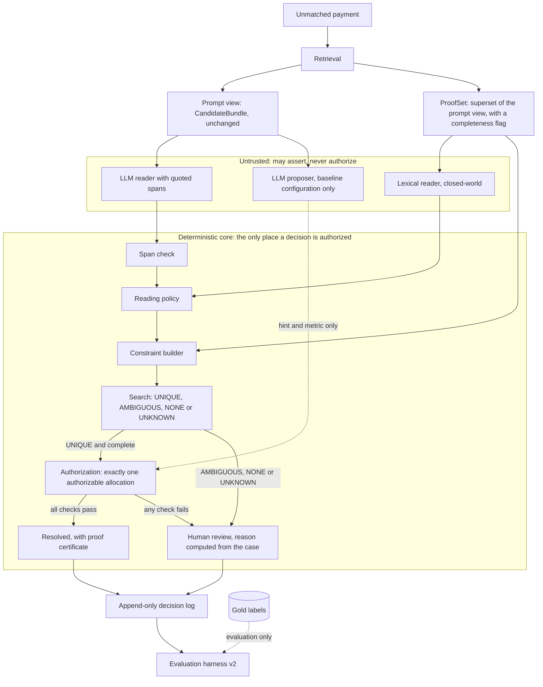

# Architecture

Status: frozen. Changes go through a new entry in `DESIGN_DECISIONS.md`, approved by the owner. An implementer never changes architecture.

Paths are relative to the repository root. A path followed by a line number exists at commit `80fc1d7`. A path marked (new) does not exist yet.

## 1. Current system (v0)

One synchronous function, `process_payment` (`backend/app/services/pipeline.py:40-193`), runs these stages. It is file-backed and read-only. It has no database, queue or authentication.

| # | Stage | Code | Behaviour today |
| --- | --- | --- | --- |
| 1 | Retrieval | `backend/app/services/candidate_retriever.py:145-286` | Scores every record in the dataset. Keeps at most 4 emails (`:172`), 3 customers (`:223`), 8 invoices in total (`:255`), 3 credits in total (`:277`). Does not report truncation. Returns a `CandidateBundle`. |
| 2 | Replay gate | `pipeline.py:51-77` | A payment that shares a bank-transaction fingerprint with another payment goes to human review. |
| 3 | Rules-only baseline | `backend/app/services/baseline_matcher.py:40-197` | Matches when the payer maps to a candidate customer and exactly one safe allocation exists inside the bundle. |
| 4 | Status gate | `pipeline.py:104-126` | A payment that is not `unmatched` goes to human review. |
| 5 | Investigator | `pipeline.py:128-144`, `backend/app/services/ai_investigator.py:106-175` | One model call returns an `InvestigationProposal`. Any `InvestigatorError` becomes human review. |
| 6 | Proof | `backend/app/services/proof_engine.py:100-452` | Recomputes totals, states, currency, duplicate risk, payer relationship, credit rules and email contradictions for the proposed allocation. |
| 7 | Alternatives | `backend/app/services/alternative_finder.py:29-113` | Enumerates every non-empty invoice subset per customer in the bundle, with credit subsets of size up to 3, and keeps those whose net equals the payment exactly. |
| 8 | Sufficiency gate | `backend/app/services/evidence_sufficiency.py:341-414` | Resolves only when ten conditions all hold (`:382-395`). |
| 9 | Reader | `backend/app/utils/remittance_semantics.py:429-464` | Regex families tag each clause as affirmative, negated, non-current or correction. Used by stages 1, 3, 6 and 8. |
| 10 | Artifacts and API | `backend/app/services/decision_artifacts.py`, `backend/app/utils/results.py`, `backend/app/api/` | Builds proof or blocked-decision artifacts. Serves a published, hash-verified result snapshot and a bounded sandbox. |

Facts that constrain every later change:

- **The model's text is never read.** The gate checks only that claim evidence IDs exist (`evidence_sufficiency.py:41-46`). A decision depends on the proposal's customer, invoice set, credit set and cited IDs. The regex reader assigns all meaning to documents.
- **Evidence is evaluated relative to the proposed customer** (`evidence_sufficiency.py:104`, `proof_engine.py:353-355`). This is the cause of finding F4.
- **The bundle is both the prompt and the proof universe.** It is hashed into cache keys (`backend/app/services/evaluator.py:91-96`).
- **Every result model forbids extra fields** (`backend/app/models/decision.py`, `backend/app/models/investigation.py`) and is serialized into the published `results/details.json`.
- **The published snapshot is validated strictly** (`results.py:163-253`, `:907-939`) and read by API tests and the frontend.

## 1a. System after Phase 1 (as specified by RP-101 to RP-111)

This section describes what the Phase 1 contracts produce. It was validated in a dry run. Nothing here exists in the repository until those tasks are accepted.

Order of stages in `process_payment` after Phase 1. A stage that returns ends the function.

| # | Stage | Module | Behaviour |
| --- | --- | --- | --- |
| 1 | Retrieval with trace | `candidate_retriever.py`, `proof_set.py` (new) | `retrieve_candidates` returns the same capped bundle as at v0. `build_proof_set` returns that bundle as the prompt view, plus a proof bundle with every ranked invoice and credit, plus a completeness flag. |
| 2 | Replay gate | `pipeline.py` | Unchanged. Runs first. |
| 3 | Search | `search.py` (new) | Enumerates once, over the proof bundle. Returns `unique`, `ambiguous`, `none` or `unknown`. `unknown` returns human review with reason `search_incomplete`. The model is not called. |
| 4 | Unread gate | `unread_instructions.py` (new) | If any candidate email names an invoice or credit ID in a clause the reader cannot classify, returns human review with reason `unread_instruction`. The model is not called. |
| 5 | Rules-only baseline | `baseline_matcher.py` | Unchanged logic, over the proof bundle, using the alternatives from stage 3. |
| 6 | Status gate | `pipeline.py` | Unchanged. |
| 7 | Investigator | `pipeline.py` | Receives the prompt view, byte-identical to v0. |
| 8 | Proof and sufficiency | `proof_engine.py`, `evidence_sufficiency.py` | Run over the proof bundle with the alternatives from stage 3. Two citation rules removed (DD-08). |
| 9 | Authorization | `authorization.py` (new) | Only when stage 8 passes: the proposal must name the single authorizable allocation. Otherwise review with `multiple_authorizable_allocations` or `proposal_not_authorizable`. |

Stated limits of the Phase 1 system. Each is deliberate and each is visible in a test or a contract.

1. **Search limits.** `unknown` when retrieval dropped an email or a strongly indicated customer, or when a customer has more than 16 eligible invoices or more than 3 eligible credits (DD-06).
2. **The strict unread rule costs automation** on any email that mentions a document in a sentence the reader does not know. Zero cost on the legacy corpus. Measured in Phase 4.
3. **The F2 residual is open.** A sentence that is fully classified and classified wrongly is not caught. One probe stays marked as an expected failure.
4. **The verifier-only baseline enumerates over the prompt view**, because it is an `Investigator` and receives what the model receives. The runtime authorizes over the proof bundle. They agree on all 80 legacy payments. Where the cap hides the only authorizable allocation, the baseline proposes nothing. That makes the baseline conservative, not unsound.
5. **`backend/scripts/run_spike.py` calls the matcher and the gate directly.** It does not pass through `process_payment` and gets none of the Phase 1 gates. It is a development script and not an authorization path. It is left untouched and must not be cited as system behaviour.
6. **Exceptions propagate.** There is no catch-all inside the core. The reason `internal_error` is reserved and not scheduled.

## 1b. System after Phase 5 (as specified by RP-501 to RP-508)

Validated in a dry run on top of the tree after RP-305. Nothing here exists in the repository until those tasks are accepted.

One stage changes: the search. Its place in `process_payment`, its four outcomes and the early return on `unknown` are as in section 1a. What it calls is new.

| Step | Module | What happens |
| --- | --- | --- |
| Limits | `backend/app/services/search.py` | `unknown` without searching when retrieval was incomplete, when a customer has more than 64 eligible invoices, or when an eligible invoice has more than 8 eligible credits linked to it |
| Problem | `backend/app/solver/problem.py`, `minor_units.py` | Amounts become integer minor units. Each eligible invoice becomes an item. Its options are the subsets of its credits that fit the invoice. One group of items per customer. |
| Search | `backend/app/solver/branch_and_bound.py` | Depth-first, one group at a time, two pruning bounds. Stops at 2,000,000 nodes or at the 2049th allocation. |
| Outcome | `backend/app/services/search.py` | A stopped search is `unknown` with no allocation. A finished one is `none`, `unique` or `ambiguous` with every allocation, built field for field as the enumerator built them. |

The enumerator (`alternative_finder.py`) is unchanged. It is still called by the verifier-only baseline, by the rules-only matcher when it is given no alternatives, and by `run_spike.py`, and it is a reference in tests. It no longer decides anything in `process_payment`.

Stated limits after Phase 5, in addition to items 2 to 6 of section 1a:

1. **Search limits.** As in the table. Item 1 of section 1a is replaced.
2. **The node budget is reached often on large ledgers.** On synthetic ledgers of 64 invoices the search answers 119 of 360 (`docs/solver_scaling.md`, RP-508). The rest go to review.
3. **The verifier-only baseline still uses the enumerator over the prompt view.** It is unaffected by the new limits, and it stays conservative for the same reason as before.

## 1c. System after the written part of Phase 6 (as specified by RP-601, RP-604, RP-606, RP-605, RP-603)

Validated in a dry run on top of the tree after RP-508. Nothing here exists in the repository until those tasks are accepted.

One decision step changes (RP-606). Directly after the rules-only matcher returns a match, the pipeline asks the proof engine for the contradictions of the matched allocation, through its canonical proposal. If there is one, the match is refused and the payment continues as an unmatched payment: to the investigator and through the gate. The matcher itself is unchanged, so the `rules_only` system of the benchmark is still the plain matcher.

One module is added beside the decision path (RP-605). `backend/app/services/review_reason.py` assesses a case without any proposal: decidable automatically or not, on which allocation, and if not, the first thing that stops it. `process_payment` does not call it and no result contains it yet. RP-803 decides what is published.

Stated limits after Phase 6, in addition to those of sections 1a and 1b:

1. **The rules-only path trusts the reader's patterns.** A prohibition whose identifier is spelled another way (F6) and a hold with no identifier (F7) do not stop a match. Nine strict probes record this. Phase 4 is where it is designed away or measured.
2. **Only the matched customer's emails can refuse a match.** An email filed under another customer does not count, by the proof engine's own rule (RP-606, test 7).
3. **The reason on a published review decision still describes the proposal.** On the legacy corpus it equals the case's reason for 5 of 18 review decisions (RP-605).
4. **Mutation testing covers five files.** The matcher, the proof engine, the gate and the pipeline are not covered yet, and a first look found survivors there (RP-607).

## 2. Target system

The model stops proposing allocations and starts reading documents. A deterministic core derives the allocation and is the only place a decision is authorized. The proposal-based configuration stays runnable as a baseline.

### 2.1 Components

| Component | Trust | May assert | May authorize | Introduced by |
| --- | --- | --- | --- | --- |
| Retrieval, prompt view | Trusted code, untrusted completeness | No | No | Exists |
| `ProofSet` builder | Trusted | No | No | RP-101 |
| Lexical reader | Untrusted output | Yes | No | Exists; closed-world in RP-107 and RP-108 |
| LLM reader | Untrusted output | Yes | No | RP-405 |
| LLM proposer | Untrusted output | Yes (a hypothesis) | No | Exists |
| Span check | Trusted | No | No | RP-404 |
| Reading policy | Trusted | No | No | RP-406 |
| Constraint builder | Trusted | No | No | RP-407 |
| Search | Trusted | No | No | RP-102; solver built in RP-501 to RP-504, used from RP-507 |
| Authorization | Trusted | No | **Yes, alone** | Exists as the sufficiency gate; made proposal-independent in RP-110 |
| Decision log | Trusted | No | No | RP-703 |
| Evaluation harness v2 | Evaluation only | No | No | RP-302 |

### 2.2 Trust boundaries

1. Document text reaches only readers. It cannot change a rule, a threshold or the eligible record set.
2. A reader narrows the set of allocations. It cannot add a record that is not in the `ProofSet`.
3. The model sees the prompt view. Uniqueness is decided on the `ProofSet`.
4. Unknown is an answer. A cap, a budget, a timeout, an unread instruction, an ambiguous identifier or a reader disagreement each produce a named reason for human review.
5. Gold labels reach only evaluation code. Sealed test data reaches only the sealed-run script.

### 2.3 Authorization rule (target)

A payment is resolved if and only if all of the following hold:

1. The search over the `ProofSet` is complete.
2. Exactly one financially valid allocation is authorizable under the proof checks and the reading policy, counting evidence from every candidate customer.
3. No candidate email names an invoice or credit ID in a clause the reader could not classify (DD-07, strict form).
4. In proposal mode only: the proposed allocation equals that one allocation.

Everything else is human review with a reason computed from the case.

## 3. Module map

Authorization-critical modules are marked AC. A task may change an AC module only when its contract names the file and the invariants it must preserve.

### 3.1 Existing

| Module | AC | Role |
| --- | --- | --- |
| `backend/app/services/pipeline.py` | AC | Orchestration and gates |
| `backend/app/services/candidate_retriever.py` | AC | Retrieval and caps |
| `backend/app/services/baseline_matcher.py` | AC | Rules-only path |
| `backend/app/services/alternative_finder.py` | AC | Enumeration |
| `backend/app/services/proof_engine.py` | AC | Proof checks |
| `backend/app/services/evidence_sufficiency.py` | AC | Gate |
| `backend/app/utils/remittance_semantics.py` | AC | Reader |
| `backend/app/utils/normalization.py`, `money.py` | AC | Identifiers, exact money |
| `backend/app/models/` | AC | Data contracts |
| `backend/app/services/ai_investigator.py` | | Model client |
| `backend/app/services/evaluator.py` | | Legacy evaluator. Frozen (DD-21). |
| `backend/app/utils/results.py`, `backend/app/api/` | | Published snapshot and API. Frozen through Phase 7 (DD-01). |
| `backend/app/services/audit_builder.py`, `decision_artifacts.py` | | Explanations |
| `backend/scripts/evaluate.py`, `generate_dataset.py`, `run_spike.py` | | Write into `results/` or `data/`. Never run with default paths (R-12). |

### 3.2 New, by phase

| Phase | Path (new) | Role |
| --- | --- | --- |
| 0 | `backend/scripts/freeze_manifest.py`, `audit/v0/frozen_inputs.json` | Guard on frozen inputs |
| 0 | `backend/tests/test_soundness_probes.py` | Findings as strict expected failures |
| 0 | `backend/app/services/verifier_only.py` | Verifier-only baseline |
| 0 | `backend/scripts/audit_baseline.py`, `audit/v0/verifier_only_baseline.json` | Audit report |
| 0 | `docs/audit_baseline.md` | Baseline record |
| 1 | `backend/app/services/proof_set.py`, `backend/app/services/search.py` | `ProofSet`, `SearchOutcome`, `search` (RP-101, RP-102). Both AC. |
| 1 | `backend/app/services/unread_instructions.py` | Unread gate (RP-108). AC. |
| 1 | `backend/app/services/authorization.py` | Proposal-independent authorization (RP-110). AC. |
| 1 | `backend/tests/test_proof_set.py`, `test_search.py`, `test_pipeline_search.py`, `test_gate_search.py`, `test_unread_mentions.py`, `test_unread_gate.py`, `test_derived_citations.py`, `test_authorization.py`, `test_search_properties.py` | Phase 1 tests |
| 1 | `audit/v1/verifier_only_baseline.json`, `docs/audit_v1.md` | Audit generation v1 and the Phase 1 record (RP-111) |
| 2 | `backend/remitbench/`: `schema.py`, `adapter.py`, `oracle.py`, `validate.py`, `labelling.py`, `expand.py`, `seal.py`, `leak.py` | Benchmark tooling (RP-201 to RP-208). Holds gold labels. Never imported by `backend/app/`. |
| 2 | `backend/scripts/remitbench_validate.py`, `remitbench_labelling.py`, `remitbench_expand.py`, `remitbench_seal.py` | Owner commands. They print identifiers, counts and hashes only. |
| 2 | `bench/`: `AUTHORING_GUIDE.md`, `seed_template.json`, `examples/` | Documents and tooling fixtures. Later, written by the owner: `seeds/dev/`, `TEST_COMMITMENT.json`, `TEST_FINGERPRINTS.json`, the split record, `test_access_log.md`. |
| 3 | `backend/remitbench/`: `stats.py`, `systems.py`, `scoring.py`, `report.py`, `baselines.py`, `recorder.py`, `prompts/abstaining_baseline.txt` | Statistics, named systems, decisions files, metrics, results table, two baselines, run recorder (RP-301 to RP-306). Not under `backend/app/`: this code reads gold labels. |
| 3 | `backend/scripts/remitbench_eval.py`, `remitbench_record.py` | Commands: run a model-free system, build the table, record repeated runs with a manifest |
| 4 | `backend/app/reading/` | Assertions, readers, span check, policies |
| 5 | `backend/app/solver/`: `minor_units.py`, `problem.py`, `branch_and_bound.py` | Exact solver (RP-501 to RP-504). AC. Integers only. Its only consumer under `backend/app/` is `search.py` (RP-507). |
| 5 | `backend/tests/cpsat_oracle.py` | CP-SAT oracle (RP-506). A test helper. OR-Tools is a development dependency (RP-505) and is never imported under `backend/app/`. |
| 5 | `backend/tests/test_solver_problem.py`, `test_solver_search.py`, `test_solver_solution_limit.py`, `test_solver_node_budget.py`, `test_solver_differential.py`, `test_search_solver.py`, `test_solver_scaling.py` | Phase 5 tests |
| 5 | `backend/scripts/solver_scaling.py`, `docs/solver_scaling.json`, `docs/solver_scaling.md` | Scaling experiment on synthetic ledgers and its pinned table (RP-508) |
| 6 | `backend/tests/properties/`: `strategies.py`, `test_decision_properties.py`, `test_amount_properties.py` | Property suite and the case generator (RP-601) |
| 6 | `backend/tests/test_hostile_inputs.py` | Hostile-input tests and the probes for F5 to F7 (RP-604). The planned directory `backend/tests/adversarial/` is not created. |
| 6 | `backend/app/services/authorization.py` (`match_contradictions`), `backend/tests/test_match_contradictions.py` | A match must survive its own proof (RP-606). AC. |
| 6 | `backend/app/services/review_reason.py`, `backend/tests/test_review_reason.py` | Case assessment (RP-605). Reads AC modules. Not on the decision path. |
| 6 | `backend/scripts/mutation_run.py`, `backend/tests/test_mutation_run.py`, `docs/mutation_report.json`, `docs/mutation_triage.json` | Mutation runner, report and triage record (RP-603) |
| 7 | `backend/app/services/ledger_index.py`, `backend/app/services/decision_log.py`, `backend/scripts/bench_latency.py` | Engineering |

Phase 1, Phase 2, Phase 3 and Phase 5 paths, and the Phase 6 paths above, are defined by their contracts. Phase 4 and Phase 7 paths are fixed names for planning. Their contents are defined only when the task contract is written.

## 4. Frozen data contracts

| Contract | Rule | Reason |
| --- | --- | --- |
| `CandidateBundle` fields, order and serialization | Unchanged through Phase 8 | Prompt payload and cache identity (DD-03) |
| `backend/app/prompts/investigator.txt` | Unchanged until RP-307 | Cache identity (DD-13) |
| `Decision`, `ProcessingResult`, `ProofResult`, `SufficiencyResult`, `BaselineResult`, `AlternativeAllocation`, `Conflict`, `CounterfactualEvidence`, `EvidenceAlternativeAssessment` | No field added, removed or renamed through Phase 7. New information travels in `Decision.proof` (a free-form mapping) or in new models that are not part of `ProcessingResult`. | Published snapshot and frontend (DD-01) |
| `results/`, `data/` | Byte-frozen, guarded by the manifest | Regression fixtures (DD-14) |
| Legacy evaluator output and `EVALUATOR_VERSION` | Unchanged | DD-21 |
| Sandbox request limits (`backend/app/api/sandbox.py:39-43`) | Unchanged | DD-24 |

## 5. Decision states and reasons

`Decision.decision` keeps its three values: `matched_normally`, `resolved`, `human_review`.

Existing abstention reasons (`evidence_sufficiency.py:315-338`) keep their spelling. Reserved new reasons, each introduced only by the named task:

| Reason | Meaning | Task |
| --- | --- | --- |
| `search_incomplete` | Retrieval dropped an email or a strongly indicated customer, or the search hit a limit. Until RP-507: 16 invoices or 3 credits per customer. From RP-507: 64 invoices per customer, 8 credits per invoice, 2048 allocations or 2,000,000 nodes. The cause is in `Decision.proof["search_detail"]`. | RP-103, RP-507 |
| `unread_instruction` | A candidate email names an invoice or credit ID in a clause the reader could not classify | RP-108 |
| `multiple_authorizable_allocations` | More than one allocation would pass every check | RP-110 |
| `proposal_not_authorizable` | The proposal passes with its own citations, but it is not the single authorizable allocation | RP-110 |
| `solver_timeout` | Withdrawn 2026-11-14 (DD-22). A search that runs out of nodes is `search_incomplete` with detail `node_budget`. | Not introduced |
| `unresolved_identifier` | A mention matches zero or several ledger records | RP-402 |
| `reader_disagreement` | The reading policy rejected an assertion | RP-406 |
| `internal_error` | An exception inside the core | Not scheduled. Exceptions propagate. |

## 6. Evaluation architecture

| Layer | Location | Purpose | Lifetime |
| --- | --- | --- | --- |
| Legacy evaluator and published snapshot | `backend/app/services/evaluator.py`, `results/` | The v0 demo numbers | Frozen. Republished once by RP-803. |
| Audit reports | `audit/v0/` (RP-004), `audit/v1/` (RP-111) | Deterministic, byte-reproducible measurements on the legacy corpus. A test compares the committed report with a fresh run, so any behaviour change forces a reviewed generation bump. | From RP-004 |
| Harness v2 | `backend/remitbench/` | Named systems, decisions files, exception-only denominators, intervals, paired tests (DD-27) | From RP-301 |
| RemitBench | Tooling in `backend/remitbench/`, documents and dev seeds in `bench/`, sealed test outside the repository | Independent evidence | Tooling from RP-201. Data from H-201 to H-205. |

The legacy corpus is a regression fixture. No number computed on it is reported as evidence of quality after Phase 0.

## 7. Guaranteed and measured

Guaranteed under three assumptions. If (A1) ledger records are correct, (A2) accepted assertions state what the documents mean, and (A3) the search is sound and complete whenever it reports completeness, then every resolved payment has an allocation that satisfies all financial constraints and is the only one consistent with the accepted assertions.

Measured only. A2 cannot be proved for natural language. It is estimated as a false authorization rate with a confidence bound on text the system was not written against. A3 is supported by differential testing against an independent solver.

No document, test name or report in this project may state a guarantee without naming A1 to A3.

## 8. Out of scope

Write operations, payment execution, ERP integration, currency conversion, authentication, databases, queues, microservices, fine-tuning, embeddings, additional LLM agents, LLM self-reported confidence as an authorization input, and visual redesign. See DD-25.
