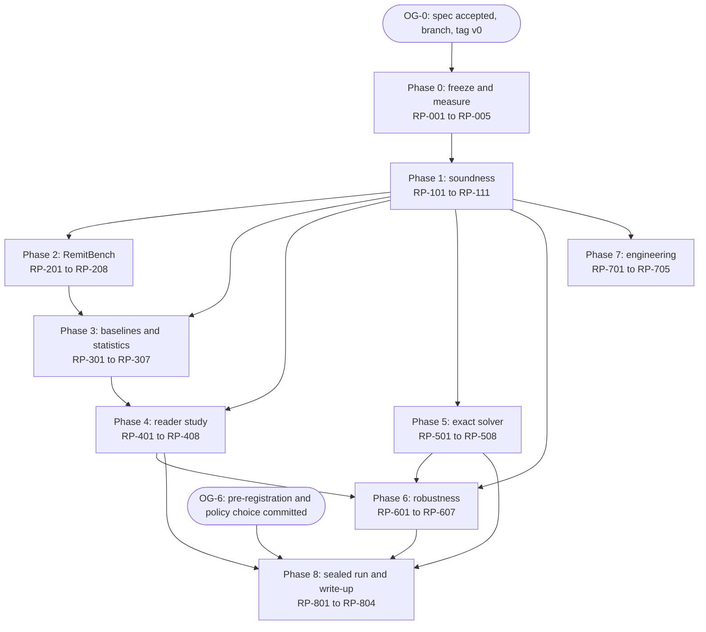

# Dependency graph

A task starts only when every dependency is accepted and committed. Owner gates (`OG-n`) are defined in `PROGRESS_LEDGER.md`.

## Phase view

## Critical path

By dependency: 182 implementation hours, 44 tasks. It is the whole written line below (174 hours, 43 tasks) and then RP-607. That is an effect of the line: each written contract starts on the tree of the one before it, so Phase 6 now follows Phase 5 although by code it needs only Phase 1 and the solver. The path to the sealed run is shorter: the written line up to RP-507, then RP-801, RP-802, RP-804, 157 hours. The path through the unwritten Phase 4 (RP-405, RP-408, then RP-801) is 145 hours and becomes the longer of those two if Phase 4 grows by 13 hours when its contracts are written.

The written contracts form one line, because each states the suite totals of the one before it. That line is 174 implementation hours.

The longest wait is not on any of these paths. It is the human benchmark work (H-202, H-203): other people's time. Meet OG-3 in week 1 and send the guide then.

## Order of the written contracts

| Phase | Order | Suite at the end |
| --- | --- | --- |
| 0 | RP-001, RP-002, RP-003, RP-004, RP-005 | 318 passed, 8 expected failures |
| 1 | RP-101, RP-102, RP-103, RP-104, RP-107, RP-108, RP-109, RP-110, RP-105, RP-106, RP-111 | 430 passed, 1 expected failure |
| 2 | RP-201, RP-204, RP-202, RP-208, RP-203, RP-205, RP-206, RP-207 | 565 passed, 1 expected failure |
| 3 | RP-301, RP-302, RP-306, RP-304, RP-303, RP-305 | 657 passed, 1 expected failure |
| 5 | RP-501, RP-502, RP-503, RP-504, RP-505, RP-506, RP-507, RP-508 | 793 passed, 1 expected failure |
| 6 | RP-601, RP-604, RP-606, RP-605, RP-603 | 914 passed, 10 expected failures |

Do not hand two tasks to two agents at once, and do not reorder. Some tasks have no code dependency on the one before them. Their dependency is on the totals.

Phase 5 was written to start after RP-305 and joins the end of the line. The written part of Phase 6 was written to start after RP-508 and joins after it. A contract written later (Phase 4, Phase 7 onward, RP-307, RP-602 and RP-607) must state the tree it starts from. If it is written to start after RP-603, it joins the end of this line. If it is written to start on an earlier tree, every written contract after that point must be re-derived on top of it: the totals of only one line can stand.

## What can run in parallel

| Lane | Tasks | Condition |
| --- | --- | --- |
| Human seed work | H-201, H-202, then H-203 and H-204 | OG-3. Needs only the guide, the template and the examples, which are printed in the contracts RP-203 and RP-201. It does not wait for code. |
| Live model runs | H-302 | OG-5 and RP-305. The owner runs the three model systems on the dev split. Nothing else waits for a model. |

Phase 7 (from RP-701) opens after Phase 1 by dependency. Its contracts are not written, and the same rule applies: a contract states totals for one start tree.

## Rules for scheduling

1. One authorization-critical task in flight at a time.
2. A task that removes a probe marker runs alone, and the full suite is the first thing the reviewer runs.
3. A dependency-changing task (RP-105, RP-505, RP-603, RP-705) is split in two steps: the implementer edits the `.in` file, the owner regenerates locks. Nothing else lands between the two steps.
4. RP-302 and RP-401 wait for `audit/v1/` (RP-111), so every later measurement is taken on the corrected verifier.
5. RP-801 runs once. A second run needs a written reason in the access log before it starts.
6. Nothing outside the written order is merged between RP-001 and RP-603 unless its contract was written for that exact start tree.

## Complete edge table

| Task | Depends on | Unblocks |
| --- | --- | --- |
| RP-001 | OG-0 | RP-002 |
| RP-002 | RP-001 | RP-003 |
| RP-003 | RP-002 | RP-004 |
| RP-004 | RP-003 | RP-005 |
| RP-005 | RP-004 | RP-101 |
| RP-101 | RP-005, OG-1 | RP-102, RP-701 |
| RP-102 | RP-101 | RP-103, RP-106, RP-501 |
| RP-103 | RP-102 | RP-104 |
| RP-104 | RP-103 | RP-107 |
| RP-105 | RP-110, OG-2 | RP-106, RP-601 |
| RP-106 | RP-105, RP-102 | RP-111, RP-506, RP-601 |
| RP-107 | RP-104 | RP-108 |
| RP-108 | RP-107 | RP-109, RP-403 |
| RP-109 | RP-108 | RP-110 |
| RP-110 | RP-109 | RP-105, RP-111, RP-407, RP-507, RP-601, RP-604, RP-605, RP-606, RP-703 |
| RP-111 | RP-110, RP-106 | RP-201, RP-401 |
| RP-201 | RP-111 | RP-204 |
| RP-202 | RP-204 | RP-208 |
| RP-203 | RP-208 | RP-205 |
| RP-204 | RP-201 | RP-202 |
| RP-205 | RP-203 | RP-206 |
| RP-206 | RP-205 | RP-207 |
| RP-207 | RP-206 | RP-301 |
| RP-208 | RP-202 | RP-203 |
| RP-301 | RP-207 | RP-302 |
| RP-302 | RP-301 | RP-306 |
| RP-303 | RP-304 | RP-305 |
| RP-304 | RP-306 | RP-303 |
| RP-305 | RP-303 | RP-307, RP-405, RP-501 |
| RP-306 | RP-302 | RP-304, RP-408 |
| RP-307 | RP-305, OG-5 | none |
| RP-401 | RP-111 | RP-402, RP-403 |
| RP-402 | RP-401 | RP-404 |
| RP-403 | RP-401, RP-108 | RP-406 |
| RP-404 | RP-402 | RP-405, RP-406 |
| RP-405 | RP-404, RP-305 | RP-408 |
| RP-406 | RP-403, RP-404 | RP-407 |
| RP-407 | RP-406, RP-110 | RP-408 |
| RP-408 | RP-407, RP-405, RP-306, H-205 | RP-602, RP-801 |
| RP-501 | RP-305, RP-102 | RP-502, RP-505 |
| RP-502 | RP-501 | RP-503 |
| RP-503 | RP-502 | RP-504 |
| RP-504 | RP-503 | RP-505, RP-506 |
| RP-505 | RP-504, RP-501, OG-2 | RP-506 |
| RP-506 | RP-505, RP-504, RP-106 | RP-507 |
| RP-507 | RP-506, RP-110 | RP-508, RP-603, RP-801, RP-803, RP-901 |
| RP-508 | RP-507 | RP-601 |
| RP-601 | RP-508, RP-106, RP-110, RP-105 | RP-603, RP-604, RP-605 |
| RP-602 | RP-408, H-205 | none |
| RP-603 | RP-605, RP-601, RP-507 | RP-607 |
| RP-604 | RP-601, RP-110 | RP-606 |
| RP-605 | RP-606, RP-601, RP-110 | RP-603, RP-803 |
| RP-606 | RP-604, RP-110 | RP-605 |
| RP-607 | RP-603 | none |
| RP-701 | RP-101 | RP-702, RP-704 |
| RP-702 | RP-701 | none |
| RP-703 | RP-110 | none |
| RP-704 | RP-701 | none |
| RP-705 | OG-2 | none |
| RP-801 | RP-408, RP-507, H-205, H-601, OG-6 | RP-802 |
| RP-802 | RP-801 | RP-804 |
| RP-803 | RP-507, RP-605 | RP-804 |
| RP-804 | RP-802, RP-803 | none |
| RP-901 | RP-507 | none |

## Task view

```mermaid
flowchart LR
    subgraph P0["Phase 0. Freeze and measure"]
        RP001["RP-001"]
        RP002["RP-002"]
        RP003["RP-003"]
        RP004["RP-004"]
        RP005["RP-005"]
    end
    subgraph P1["Phase 1. Close the soundness gaps"]
        RP101["RP-101"]
        RP102["RP-102"]
        RP103["RP-103"]
        RP104["RP-104"]
        RP105["RP-105"]
        RP106["RP-106"]
        RP107["RP-107"]
        RP108["RP-108"]
        RP109["RP-109"]
        RP110["RP-110"]
        RP111["RP-111"]
    end
    subgraph P2["Phase 2. RemitBench v1"]
        RP201["RP-201"]
        RP202["RP-202"]
        RP203["RP-203"]
        RP204["RP-204"]
        RP205["RP-205"]
        RP206["RP-206"]
        RP207["RP-207"]
        RP208["RP-208"]
    end
    subgraph P3["Phase 3. Baselines and statistics"]
        RP301["RP-301"]
        RP302["RP-302"]
        RP303["RP-303"]
        RP304["RP-304"]
        RP305["RP-305"]
        RP306["RP-306"]
        RP307["RP-307"]
    end
    subgraph P4["Phase 4. Reader study"]
        RP401["RP-401"]
        RP402["RP-402"]
        RP403["RP-403"]
        RP404["RP-404"]
        RP405["RP-405"]
        RP406["RP-406"]
        RP407["RP-407"]
        RP408["RP-408"]
    end
    subgraph P5["Phase 5. Exact solver"]
        RP501["RP-501"]
        RP502["RP-502"]
        RP503["RP-503"]
        RP504["RP-504"]
        RP505["RP-505"]
        RP506["RP-506"]
        RP507["RP-507"]
        RP508["RP-508"]
    end
    subgraph P6["Phase 6. Robustness"]
        RP601["RP-601"]
        RP602["RP-602"]
        RP603["RP-603"]
        RP604["RP-604"]
        RP605["RP-605"]
        RP606["RP-606"]
        RP607["RP-607"]
    end
    subgraph P7["Phase 7. Engineering"]
        RP701["RP-701"]
        RP702["RP-702"]
        RP703["RP-703"]
        RP704["RP-704"]
        RP705["RP-705"]
    end
    subgraph P8["Phase 8. Final run and write-up"]
        RP801["RP-801"]
        RP802["RP-802"]
        RP803["RP-803"]
        RP804["RP-804"]
    end
    subgraph P9["Optional"]
        RP901["RP-901"]
    end
    OG0(["OG-0"])
    OG1(["OG-1"])
    OG2(["OG-2"])
    OG5(["OG-5"])
    OG6(["OG-6"])
    OG0 --> RP001
    RP001 --> RP002
    RP002 --> RP003
    RP003 --> RP004
    RP004 --> RP005
    RP005 --> RP101
    OG1 --> RP101
    RP101 --> RP102
    RP102 --> RP103
    RP103 --> RP104
    RP110 --> RP105
    OG2 --> RP105
    RP105 --> RP106
    RP102 --> RP106
    RP104 --> RP107
    RP107 --> RP108
    RP108 --> RP109
    RP109 --> RP110
    RP110 --> RP111
    RP106 --> RP111
    RP111 --> RP201
    RP204 --> RP202
    RP208 --> RP203
    RP201 --> RP204
    RP203 --> RP205
    RP205 --> RP206
    RP206 --> RP207
    RP202 --> RP208
    RP207 --> RP301
    RP301 --> RP302
    RP304 --> RP303
    RP306 --> RP304
    RP303 --> RP305
    RP302 --> RP306
    RP305 --> RP307
    OG5 --> RP307
    RP111 --> RP401
    RP401 --> RP402
    RP401 --> RP403
    RP108 --> RP403
    RP402 --> RP404
    RP404 --> RP405
    RP305 --> RP405
    RP403 --> RP406
    RP404 --> RP406
    RP406 --> RP407
    RP110 --> RP407
    RP407 --> RP408
    RP405 --> RP408
    RP306 --> RP408
    H205 --> RP408
    RP305 --> RP501
    RP102 --> RP501
    RP501 --> RP502
    RP502 --> RP503
    RP503 --> RP504
    RP504 --> RP505
    RP501 --> RP505
    OG2 --> RP505
    RP505 --> RP506
    RP504 --> RP506
    RP106 --> RP506
    RP506 --> RP507
    RP110 --> RP507
    RP507 --> RP508
    RP508 --> RP601
    RP106 --> RP601
    RP110 --> RP601
    RP105 --> RP601
    RP408 --> RP602
    H205 --> RP602
    RP605 --> RP603
    RP601 --> RP603
    RP507 --> RP603
    RP601 --> RP604
    RP110 --> RP604
    RP606 --> RP605
    RP601 --> RP605
    RP110 --> RP605
    RP604 --> RP606
    RP110 --> RP606
    RP603 --> RP607
    RP101 --> RP701
    RP701 --> RP702
    RP110 --> RP703
    RP701 --> RP704
    OG2 --> RP705
    RP408 --> RP801
    RP507 --> RP801
    H205 --> RP801
    H601 --> RP801
    OG6 --> RP801
    RP801 --> RP802
    RP507 --> RP803
    RP605 --> RP803
    RP802 --> RP804
    RP803 --> RP804
    RP507 --> RP901
```

Task-level graph (64 tasks and the owner gates)

